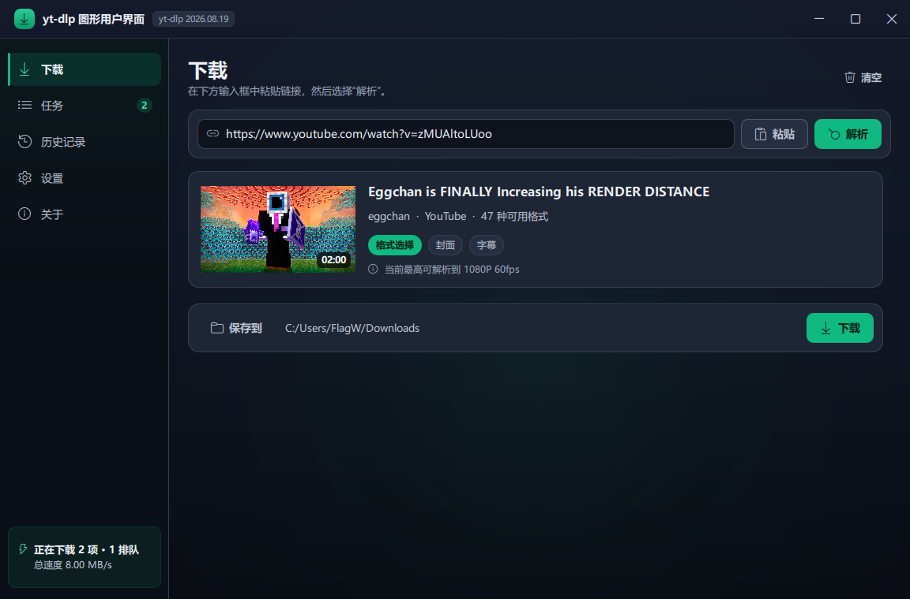

# FlowFetch

> 适用于 [yt-dlp](https://github.com/yt-dlp/yt-dlp) 的 Windows 桌面图形界面。
> 中文界面，深色 / 浅色主题，Qt Quick 自绘界面。



粘贴链接、点“解析”、选画质，即可开始下载。

---

## 快速开始

### 环境要求

| 项目 | 要求 |
| --- | --- |
| 操作系统 | Windows 10 / 11 |
| Python | 3.10 或更高版本（已在 3.14 上验证） |
| 依赖 | PySide6、yt-dlp（见 `requirements.txt`） |
| FFmpeg | 可选，但推荐安装；未安装时程序会提示下载 |

### 安装与启动

```powershell
pip install -r requirements.txt
```

双击 **`启动.bat`** 启动。遇到问题时请使用 **`调试启动.bat`**，它会保留控制台日志。

也可以直接用命令行启动：

```powershell
python -m app.main
```

### 关于组件：FFmpeg 与 yt-dlp

这两个组件都由程序自己管理，**更新时不需要重新打包分发，也不会改动你系统里的 Python 环境**。

**FFmpeg** —— 有两种来源模式，可在“设置 → 组件 → FFmpeg 来源”中切换：

| 模式 | 说明 |
| --- | --- |
| **由本程序下载并管理**（默认） | 启动时检测组件目录，未安装则提示从 Internet 下载；有新版本时提示更新。完全不使用系统 PATH。 |
| **使用我已安装的** | 指定一个包含 `ffmpeg.exe` 的文件夹（也可以直接填 `ffmpeg.exe` 的完整路径），程序会立即检测并显示版本号。路径失效时会给出明确警告，并临时回退到组件目录。 |

托管模式下的查找顺序：程序组件目录 `%APPDATA%\YtDlpGui\bin` → 程序安装目录下的 `bin`。

**yt-dlp** —— 优先从程序组件目录 `%APPDATA%\YtDlpGui\lib` 加载，
该目录优先级高于系统 Python 中已安装的 yt-dlp。选择“设置 → 组件 → 更新”时，
程序会直接从 PyPI 下载官方 wheel 并解压到该目录（**不调用 pip**），
因此即使把程序打包成 exe 分发，用户也能自行更新下载引擎。

两个组件都会在启动时自动检查是否有新版本，有更新时标题栏的版本标签会变色并给出提示。

---

## 功能

**下载**
- 粘贴链接即可识别，支持 YouTube、Bilibili 等 1800 多个站点
- 解析后显示封面、标题、作者、时长与可用格式数量
- 画质预设：最佳画质 / 4K / 1080P / 720P / 480P / 最小体积
- “仅音频”可直接提取 MP3、M4A、Opus、FLAC、WAV
- “更多格式…”可打开完整格式表，按分辨率、编码、体积逐条选择
- 播放列表会展开为可勾选列表，支持全选、取消全选后批量下载
- 支持把链接直接拖入窗口

**哔哩哔哩**
- 支持手机客户端**扫码登录**，登录凭据只保存在本机
- 画质档位按解析结果动态生成：只显示真正可下载到的分辨率，
  未登录时 4K / 2K 以带锁图标的灰化档位呈现，点击即可发起登录
- 登录后可解析 1080P 高码率、4K、8K、HDR 与 60fps 等需要大会员的内容
- 下载与解析时会自动为哔哩哔哩链接携带登录 Cookies，不影响其它站点使用的 Cookies 配置

**任务**
- 每个任务显示缩略图、进度、速度、剩余时间与体积
- 可同时下载多个任务，并按分片并发加速
- 暂停、继续、取消、重试、打开所在文件夹、播放文件
- 失败任务可展开查看 yt-dlp 的原始错误信息

**历史记录**
- 自动记录每次成功下载，支持按标题搜索
- 可打开文件位置、回看原链接
- 可导出为 CSV（带 BOM，Excel 打开不乱码）

**设置**
- 常规：保存位置、文件名模板、并发任务数、分片数、重试次数
- 外观：深色 / 浅色 / 跟随系统，6 种强调色，界面缩放，动画与背景光效
- 组件：yt-dlp 与 FFmpeg 的版本检测、更新与安装
- 网络：代理、Cookies、浏览器 Cookies、限速、超时
- 下载内容：容器格式、音频格式与比特率、首选编码、字幕、封面、元数据、SponsorBlock
- 高级：手动指定 FFmpeg 目录、自定义 User-Agent 与 Referer

设置会立即生效，并保存到 `%APPDATA%\YtDlpGui\settings.json`。

---

## 键盘快捷键

| 快捷键 | 功能 |
| --- | --- |
| `Ctrl + V` | 粘贴剪贴板中的链接 |
| `Enter` | 解析输入框中的链接 |
| `Ctrl + 1 ~ 5` | 切换左侧页面 |
| `Ctrl + O` | 打开保存位置 |
| `F5` | 重新解析当前链接 |
| `Esc` | 清除当前解析结果 |

---

## 项目结构

```
ytdlp-E/
├── 启动.bat                     启动（无控制台窗口）
├── 调试启动.bat                 启动并保留日志
├── requirements.txt
├── docs/                        界面截图
├── app/
│   ├── main.py                  程序入口：窗口、主题、窗口效果、应用图标
│   ├── core/
│   │   ├── bridge.py            QML 与 Python 之间的接口
│   │   ├── downloader.py        yt-dlp 封装：选项构建、进度回调、取消、队列
│   │   ├── deps.py              FFmpeg / yt-dlp 的检测、下载与更新
│   │   ├── taskmodel.py         任务数据模型
│   │   ├── history.py           历史记录
│   │   ├── config.py            设置项定义与持久化
│   │   ├── helpers.py           单位换算、路径与资源管理器交互
│   │   └── winutil.py           Windows 窗口效果（圆角、深色标题栏、描边）
│   └── qml/                     界面（Qt Quick / QML）
│       ├── Main.qml             主窗口、标题栏、侧边栏、页面栈、快捷键
│       ├── Theme.qml            设计系统：色板、字号、圆角、图标
│       ├── *Page.qml            下载 / 任务 / 历史记录 / 设置 / 关于
│       └── *.qml                通用组件
└── tools/                       开发辅助脚本
```

---

## 常见问题

**提示未安装 FFmpeg**
在提示对话框中选择“下载”，或稍后前往“设置 → 组件”安装。

**下载某些视频时提示需要登录**
在“设置 → 网络”中配置 Cookies 文件，或选择“从浏览器读取 Cookies”。

**某个站点解析失败**
先更新 yt-dlp：在“设置 → 组件”中选择“更新”，或执行 `pip install -U yt-dlp`。

**下载速度较慢**
在“设置 → 常规”中提高“每个任务的分片数”，必要时在“设置 → 网络”中配置代理。

---

## 许可与声明

下载能力来自 [yt-dlp](https://github.com/yt-dlp/yt-dlp)（Unlicense 许可）。
请仅将此程序用于个人学习与合法备份，并遵守各站点的服务条款及当地法律法规。
